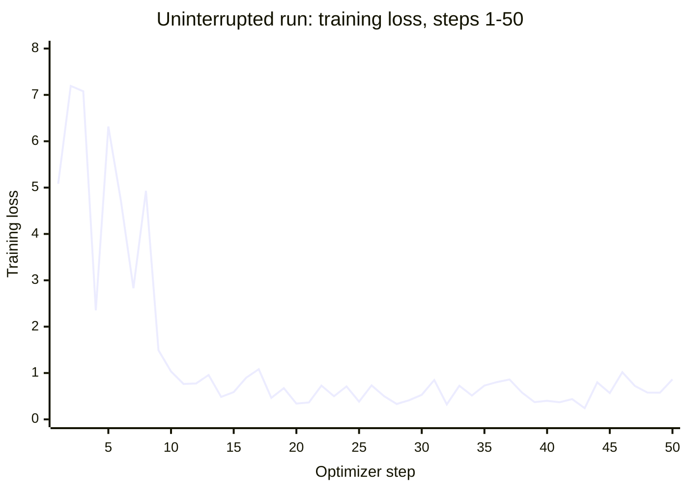
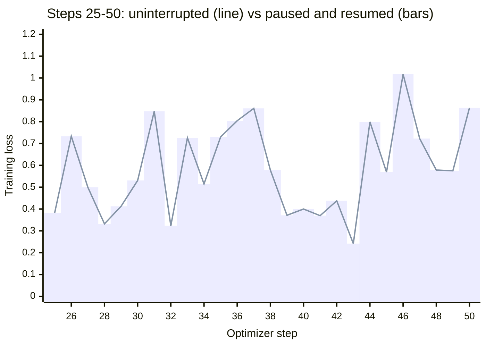

# GPU Pause and Resume Under gVisor: Final PoC Report

| | |
|---|---|
| **Tickets** | |
| **Environment** | Dev |
| **Runtime** | `runsc-root-self` |
| **GPUs** | worker-3: 2× RTX 5090 32 GB, driver 595.91.07, CUDA 13.2 · worker-4: RTX PRO 6000 Blackwell 96 GB, driver 615.71.09, CUDA 13.4 |

This report covers the three stories of the GPU pause and resume work in one document: the memory + CUDA PoC with real workloads, the memory-only restore PoC, and the benchmark. It also includes the trade-off and recommendation that follow from them. Each section follows its ticket requirement by requirement, and every requirement shows either a recorded result or a clear statement that it has not been run yet.

---

## Summary

GPU workloads often require expensive hardware resources, and keeping a GPU allocated during periods of inactivity leads to inefficient resource utilization and unnecessary costs. Today an idle AIRuntime either keeps its GPU or is deleted, and deleting it loses the loaded model, the training progress and any warmed-up caches.

GPU pause and resume solves this by preserving the workload's execution state while making the GPU available for other workloads during idle periods. Pause reuses the existing sandbox snapshot path: `runsc checkpoint` captures the workload's process memory and root filesystem into a snapshot, the pod and its GPU are released, and resume restores a new pod from that snapshot. Training continues from the step where it paused, and an inference server answers the next request without reloading the model.

PR #2409 proved this only on small workloads (GPT-2, a small PyTorch loop, ComfyUI) on one RTX 5090. This report repeats the test on real training jobs and real inference servers running open-weight models (PyTorch LoRA training, Triton Inference Server and vLLM), using two ways of handling the GPU state:

- **Memory and CUDA state checkpoint:** the snapshot keeps the workload's connection to its GPU. The workload resumes exactly as it was, but only on the same physical GPU.
- **Memory-only checkpoint:** the workload releases the GPU before the snapshot. The workload can then resume on a different GPU.

The report answers four questions:

1. Does pause and resume hold up, with no loss of state, no model reload and identical output?
2. Can a paused workload be restored on a different GPU, and what does the customer lose when it is?
3. What does it cost in checkpoint time, frozen time, checkpoint size, restore time and cold start?
4. Which settings does it force on customers?

---

## How the GPU State Is Preserved

To pause a GPU workload, the platform takes a snapshot of it with gVisor's `runsc checkpoint` and releases the GPU. On resume, a new pod is started from that snapshot and the workload continues from the point at which it was paused. A GPU workload keeps its state in two places: its process memory on the host, and its data in GPU memory, such as model weights, optimizer state and KV cache. Both must be in the snapshot.

In both approaches, NVIDIA's `cuda-checkpoint` tool moves the GPU memory into the process's host (CPU) memory, and gVisor then saves that host memory into the snapshot. Both snapshots therefore hold the same data: the process memory, which now includes the model weights, optimizer state and KV cache. The model is not reloaded from disk after restore in either approach.

The approaches differ in one respect: whether the workload still holds its GPU driver handles when gVisor takes the snapshot.

### Memory and CUDA State Checkpoint (Runtime-Driven)

gVisor runs `cuda-checkpoint` itself, as part of `runsc checkpoint --cuda-checkpoint-path=/opt/cuda-checkpoint/cuda-checkpoint`. The GPU memory is moved into host memory, but the workload keeps its open GPU driver handles, and gVisor saves them in the snapshot together with the memory. On restore, gVisor reopens those handles, the GPU memory is copied back, and the workload continues.

The saved handles refer to the physical GPU on which the snapshot was taken, so the snapshot can be restored only on that same GPU. On any other GPU the restore fails during GPU initialisation with `NV0000_CTRL_CMD_GPU_GET_ID_INFO … status=0x1f`. This is the platform's current GPU checkpoint path: when the operator sees a GPU on the pod, it adds `--cuda-checkpoint-path` to the checkpoint command.

### Memory-Only Checkpoint (In-Container CUDA Suspension)

`cuda-checkpoint` is run inside the container, for every process that holds a CUDA context, before `runsc checkpoint`:

1. `--action lock` blocks new CUDA calls; work already on the GPU finishes.
2. `--action checkpoint` moves the GPU memory into host memory and closes every GPU driver handle. GPU memory drops to 0 MiB.
3. A plain `runsc checkpoint`, without `--cuda-checkpoint-path`, saves host memory only, with no GPU handles.
4. After restore, `--action restore` opens new handles on whichever GPU the new pod has and copies the memory back, and `--action unlock` lets the workload continue.

Because the snapshot holds no GPU handles, it can be restored on a different GPU. In the operator, a `SnapshotJob` with the annotation `sandbox.neevcloud.com/cuda-suspended: "true"` already makes `sandbox-sr-operator` leave out `--cuda-checkpoint-path` and `--leave-running`. Running `cuda-checkpoint` inside the pod through the Kubernetes exec API is not implemented yet; in these tests it was run by hand with `kubectl exec`.

---

## 1. PoC: Memory + CUDA Pause and Resume With Real Workloads

**Purpose:** PR #2409 proved the memory and CUDA state checkpoint only on small workloads on one RTX 5090. This PoC checks, on real training jobs and real inference servers, whether pause and resume holds up, what it costs, and which settings it forces on customers.

### 1.1 Training

**What the ticket asks:** run a real fine-tune of an open-weight model on a public dataset, with mixed precision, gradient accumulation and a dataloader with worker processes. Pause mid-epoch, resume, and train to the end. Compare against an uninterrupted run with the same seed: the loss curve, the final eval loss, the optimizer step count and the LR-scheduler position. The loss curve must continue from the pause step with no restart, and the final eval metric must be within run-to-run noise of the uninterrupted run.

**Setup:**

| Item | Value |
|---|---|
| Model | `Qwen/Qwen2.5-7B-Instruct`, HF Transformers + PEFT LoRA (r = 16, alpha = 32, dropout 0.05, `q_proj` and `v_proj`); 4.7 M trainable weights out of 7.6 B |
| Dataset | `tatsu-lab/alpaca`, shuffled with seed 42; 2,048 training and 256 held-out evaluation examples, 256 tokens each |
| Training | bf16 mixed precision; gradient accumulation of 4 batches of 2; 2 dataloader workers; AdamW (lr 2e-4); cosine schedule with 5 warm-up steps; 50 steps; seed 42 |
| Image and memory | `harbor.neev.work/test-template/pytorch-v2.8.0-ubuntu-24.04:0.1.2`, container memory limit 32 GiB |

**How it was tested:**

1. Ran the uninterrupted run (`train-baseline-uninterrupted`) to step 50 and saved the log.
2. Started `train-pause-source` with the same script and seed, and let it reach step 25. One epoch is 256 steps, so step 25 is mid-epoch.
3. Suspended CUDA with `cuda-checkpoint` `lock` and `checkpoint` in every Python process (the trainer and the 2 dataloader workers), and confirmed 0 MiB on the GPU.
4. Ran `runsc checkpoint` on worker-3, deleted the source pod, and created `train-restore-resumed` with the same claim name, command and args, plus the restore annotation.
5. Ran `restore` and `unlock` in every Python process, followed the log to step 50, and compared it with the uninterrupted run.

The training runs used the memory-only checkpoint (CUDA suspended inside the container) on the same GPU. A training run with the memory and CUDA state checkpoint has not been recorded yet.

**Results:**

| GPU | Cold start | Checkpoint time | Checkpoint size | Restore time | Frozen time | Result |
|---|---|---|---|---|---|---|
| RTX 5090 (worker-3), same GPU | 1.95 s model load | 16 s (7 s CUDA suspension + 9 s snapshot) | 22 GB | 8–12 s; first step under 2 s after unlock | ~135 s | Passed |
| RTX PRO 6000 (worker-4), same GPU | — | 16–19 s | 23 GB | ~10 s | — | Resumed and finished; comparison invalid (see below) |

| Check | Uninterrupted run | Paused and resumed run |
|---|---|---|
| Loss / LR at step 25 (pause) | 0.382945 / 1.173648e-04 | 0.382945 / 1.173648e-04 |
| Loss / LR at step 26 (first step after resume) | 0.733229 / 1.104528e-04 | 0.733229 / 1.104528e-04 |
| Loss / LR at step 50 | 0.863332 / 0 | 0.863332 / 0 |
| Optimizer step count | 50 | 50 |
| Final eval loss | 0.507593 | 0.507593 |

Training continued at step 26 with no restart. Loss and learning rate match at every step to 6 decimal places, so the weights, the AdamW state and the LR-scheduler position all survived, and GPU memory came back to 14,778 MB with no model reload.

**Loss curve, uninterrupted run (steps 1–50; the pause is after step 25):**

**Loss curve after the pause (steps 25–50): uninterrupted run (line) against the paused and resumed run (bars):**

The line passes through the top of every bar: after the resume, the paused and resumed run follows the uninterrupted curve exactly. Both charts are drawn from the step logs in `APPROACH_A_PYTORCH_TRAINING.md`; the paused run's log is available from step 25.

**Worker-4:** the paused run finished all 50 steps with a final eval loss of 0.507348. The recorded uninterrupted worker-4 run has a different loss curve (step 1 loss 24.7 instead of 5.08, final eval loss 0.498626), so it did not use the same script, and the comparison must be rerun before it counts.

### 1.2 Triton Inference Server

**What the ticket asks:** serve at least one model through Triton, and a vLLM-backend LLM if possible. Pause while it is loaded and warmed up, then resume. Check the model repository state, model readiness and the HTTP/gRPC endpoints, and check that output after resume matches output before the pause for fixed inputs. Record whether Triton's Python backend stubs checkpoint at all.

**Setup:**

| Model | Backend and image | Processes | GPU memory |
|---|---|---|---|
| `text_embedding` | PyTorch (LibTorch), `nvcr.io/nvidia/tritonserver:24.08-py3` | `tritonserver` only | 873 MiB |
| `Qwen2.5-7B-Instruct` | vLLM backend, `harbor.neev.work/test-template/triton-server-vllm:0.2.0`; `gpu_memory_utilization 0.6`, `max_model_len 4096`, `enforce_eager` | `tritonserver` (PID 1), Python backend stub (PID 500), `VLLM::EngineCore` (PID 713) | 22,829 MiB (15.2 GB weights + 7.6 GB KV cache) |

Triton opens a CUDA context on every GPU it can see, so it used 571 MiB on the second RTX 5090 with no model there. Set `CUDA_VISIBLE_DEVICES=0` to keep it on one GPU.

**How it was tested:**

1. Loaded and warmed up the model, sent a fixed input, and saved the output.
2. Paused the server: either a memory and CUDA state checkpoint, or CUDA suspended in every process followed by a memory-only checkpoint.
3. Restored the pod with the same claim name, command and args.
4. Checked `/v2/repository/index`, server and model readiness, the HTTP endpoints and gRPC port 8001, then sent the same input and compared the output.

**Results on worker-3 (RTX 5090):**

| Model | Approach | Cold start | Checkpoint time | Checkpoint size | Restore time | Result |
|---|---|---|---|---|---|---|
| `text_embedding` | Memory and CUDA state | — | — | — | — | Passed: readiness HTTP 200, identical output |
| `text_embedding` | Memory-only | — | — | — | 6 s | Passed: model `READY`, HTTP 200, gRPC 8001 open, identical output (max difference 0.0, cosine 1.0); 5 cycles; second-generation restore in 7 s |
| Qwen2.5-7B, vLLM backend | Memory and CUDA state | 141 s (89 s cached) | 18 s | 19 GB | 9 s | Passed: identical text, `nv_inference_count` 2 → 3 |
| Qwen2.5-7B, vLLM backend | Memory-only | 141 s (89 s cached) | — | 28 GB | — | Passed: model `READY`, GPU memory back to 22,829 MiB, identical text |

"—" means not recorded.

- **No weight reload:** all three vLLM-backend processes kept their original uptime (about 30 min) after restore.
- **In-flight requests:** while CUDA is locked, a request waits and Triton keeps the HTTP connection open; after unlock it completes with HTTP 200.
- **Python backend stubs:** they checkpoint with both approaches. For a memory-only checkpoint, CUDA must be suspended in the stub as well.
- **Embedding model, 5 cycles:** 873 MiB of GPU memory and 2,127 MB of host memory after every resume, with identical output every time.
- **Not done yet:** a real gRPC inference request (only the port was checked), 5 cycles for the vLLM backend, and worker-4.

### 1.3 vLLM

**What the ticket asks:** run Whisper large-v3 (transcribe a fixed audio set before and after the pause; transcripts must match), a ~8B LLM and a ~14–32B LLM that fits on one GPU. Try both the default multi-process mode and single-process mode, confirm whether a newer runsc and `cuda-checkpoint` fix the failure seen in PR #2409, and measure what single-process mode costs if it is required. Check that a seeded greedy request returns the same tokens, prefix-cache hits continue, the weights are not reloaded, and record what happens to in-flight requests.

**Setup:** image `harbor.neev.work/test-template/vllm:0.1.5`, default multi-process mode: the API server (PID 1) and `VLLM::EngineCore` run as separate processes, and only the engine holds a CUDA context. The runs used `--enforce-eager`.

**How it was tested:**

1. Started vLLM with the model, waited for it to load, and recorded the cold start.
2. Sent the fixed input (a seeded greedy prompt with `temperature 0` and `seed 42`, or the audio set) and saved the output and the prefix-cache counters from `/metrics`.
3. Took the checkpoint, restored the pod with the same claim name, and sent the same input again.
4. Compared the output and the prefix-cache counters, and checked the log for model loading.

**Results:**

| Model | GPU | Approach | Cold start | Checkpoint time | Checkpoint size | Restore time | Result |
|---|---|---|---|---|---|---|---|
| Whisper large-v3 | RTX 5090 | Memory and CUDA state | 98 s | — | — | — | In progress |
| Whisper large-v3 | RTX 5090, Card 0 → Card 1 | Memory-only | 98 s | 4.41 s | — | 11.27 s | Reported passed with matching transcripts; log not attached |
| Qwen2.5-7B, util 0.90 (29,525 MiB), limit 48 GiB | RTX 5090 | Memory and CUDA state | — | 28 s | 18 GB | 5 s | Passed |
| Qwen2.5-14B-AWQ, util 0.90 (86.4 GB) | RTX PRO 6000 | Memory and CUDA state | 236 s | Failed | — | — | 64 GiB limit: `containerManager.Checkpoint failed: EOF`; 128 GiB: `OOMKilled` (node RAM 91.1 GiB) |
| Qwen2.5-14B-AWQ, util 0.38 (~36.5 GB) | RTX PRO 6000 | Memory and CUDA state | — | — | — | — | In progress |

"—" means not recorded.

**State checks for Qwen2.5-7B:**

- **Same tokens:** the seeded greedy prompt returned identical tokens.
- **Prefix-cache hits continue:** the counters continued from 205 queries and 128 hits instead of resetting to 0.
- **Weights not reloaded:** both processes were still running after restore, with no model loading in the log.
- **In-flight requests:** not recorded yet.

**Multi-process vs. single-process mode:** PR #2409 saw the CUDA toggle fail on the engine process in multi-process mode (`cuda-checkpoint --toggle for PID 30 failed with exit status 256`). With `runsc-20260905` and the current `cuda-checkpoint`, multi-process mode passes, so single-process mode is not required and its throughput cost was not measured. The earlier failure came from a 16 GiB memory limit and a wrong checkpoint command: `--cuda-checkpoint-path` must point to the `cuda-checkpoint` binary, and the full 64-character container ID must be passed.

**Earlier reference, GPT-2 (PR #2409), about 28.8 GB of GPU memory:** multi-process with 16 GiB failed with the toggle error; single-process with 16 GiB failed with `EOF`; single-process with 32 GiB passed, with a 14 s checkpoint, a 6.0 s restore against a 45 s cold start, identical output and no reload.

**Limit found:** processes that share GPU memory through CUDA IPC (`cudaIpcOpenMemHandle`) cannot be checkpointed. The checkpoint hung for 207 s and failed with `exit status 9`. Standard vLLM does not do this, because only the engine uses CUDA.

### 1.4 Across All Workloads

**GPUs (RTX 5090 and RTX PRO 6000 at minimum):** all workloads ran on the RTX 5090. On the RTX PRO 6000 only training (comparison invalid, see 1.1) and the 14B model (failed on host memory) have run.

**Host-memory sizing:** GPU memory is copied into the container's memory during the checkpoint, so the container memory limit must hold the GPU memory in use plus the process's own memory.

| GPU | Workload | GPU memory in use | Memory limit | Result |
|---|---|---|---|---|
| RTX 5090 | vLLM GPT-2 (PR #2409) | 28.8 GB | 16 GiB | Failed, `EOF` |
| RTX 5090 | vLLM GPT-2 (PR #2409) | 28.8 GB | 32 GiB | Passed |
| RTX 5090 | Qwen2.5-7B LoRA training | 14.4 GB | 32 GiB | Passed |
| RTX 5090 | vLLM Qwen2.5-7B | 29.5 GB | 24 GiB | Failed, `OOMKilled` |
| RTX 5090 | vLLM Qwen2.5-7B | 29.5 GB | 48 GiB | Passed |
| RTX PRO 6000 | vLLM Qwen2.5-14B-AWQ | 86.4 GB | 64 GiB | Failed, `EOF` |
| RTX PRO 6000 | vLLM Qwen2.5-14B-AWQ | 86.4 GB | 128 GiB | Failed, node out of RAM (91.1 GiB) |

**Rule:** set the container memory limit to at least **1.2× the GPU memory in use**, and make sure the node has that much free RAM. On worker-4 the GPU (96 GB) is larger than the node's RAM (91.1 GiB), so a workload that uses most of the GPU cannot be paused there. The RTX 5090 has 5 data points; the RTX PRO 6000 still needs passing runs to reach the 3 data points the ticket asks for.

**Repeat cycles (at least 5 per workload):** only the Triton embedding model has completed 5 pause and resume cycles, with identical output and no growth in GPU or host memory. Every other workload has completed 1 cycle.

**Measurements per run:** checkpoint time, frozen time, checkpoint size, restore time and cold start are given per workload above and collected in Section 3.

### 1.5 Acceptance Criteria (Memory + CUDA PoC)

- **Results table per workload × GPU with pass/fail, numbers and errors:** Sections 1.1–1.4 and the table in Section 3. Worker-3 is done for training, Triton and vLLM Qwen2.5-7B. Worker-4 is partial: the training comparison is invalid and the 14B runs failed. Whisper is not finished.
- **Every result from an actual run, with logs and manifests attached:** manifests and logs are in the source documents; the raw training logs and the Whisper memory-only log still have to be attached.
- **Training loss curve plotted against the uninterrupted run, and final eval metric compared:** done for worker-3 (Section 1.1), with identical final eval loss.
- **Triton and vLLM output matches for fixed inputs, and no weight reload:** done for Triton (both models) and vLLM Qwen2.5-7B. Not done for Whisper and the ~14–32B model.
- **Host-memory rule with at least 3 data points per GPU:** stated in Section 1.4, with 5 data points on the RTX 5090; the RTX PRO 6000 has only failures so far.

**Out of scope for this PoC:** multi-GPU (tensor parallel, DDP). Cross-card and memory-only restore are covered in Section 2.

---

## 2. PoC: Memory-Only Restore Onto a Different GPU

**Purpose:** a memory and CUDA state snapshot can be restored only on the same physical GPU. PR #2409 showed that restoring onto another RTX 5090 in the same node fails during GPU device setup, and this was confirmed with Triton (`status=0x1f`). If resume needs that exact card, a paused workload cannot come back once someone else is using the card. This PoC tests whether a memory-only restore can bring the workload back on whichever compatible GPU is free.

**Workloads:** the same as Section 1. Training (Qwen2.5-7B LoRA), Triton (embedding model and the vLLM backend) and vLLM (Whisper large-v3 and Qwen2.5-7B).

### 2.1 Can Memory-Only Work From the Same Checkpoint?

**Candidate (a): restore with CUDA left suspended, attach the new GPU, then resume CUDA on the new device.** This works, provided CUDA is suspended inside the container before the checkpoint is taken (the memory-only checkpoint described above). A snapshot taken with `--cuda-checkpoint-path` cannot be used for this, because it still holds the GPU driver handles, and gVisor tries to reopen them on the original GPU before CUDA can be moved, which fails with `status=0x1f`.

The tested steps were:

1. Deploy the workload on the source GPU, with a claim for that GPU and `/opt/cuda-checkpoint` mounted from the host.
2. Confirm that the model is loaded and the workload is running.
3. Run `lock` and then `checkpoint` in every CUDA process, and check that `--get-state` reports `checkpointed` and the GPU shows 0 MiB.
4. Run `runsc checkpoint` on the node, without `--cuda-checkpoint-path`.
5. Delete the source pod and create the restore pod with the same claim name. The claim's selector points to the target GPU UUID; the command, args and restore annotation stay the same.
6. Run `restore` and then `unlock` in each process.
7. Verify the output, or check that the training loss continues.

**Candidate (b): the application's own offload.**

- **vLLM sleep mode does not work in the tested build** (`vllm:0.1.5`, vLLM 0.19.0). With `POST /sleep?level=1` and `level=2`, vLLM logged `Sleep mode freed 0.73 GiB memory, 18.89 GiB memory is still in use`. It dropped only the KV cache and kept the weights on the GPU, and the checkpoint then failed with `nvproxy: … miscObject is not restorable`.
- **vLLM `/pause`:** the GPU memory belongs to `EngineCore` (PID 43), not to the API server (PID 1). `/pause` drains requests and resets the prefix cache, but it does not free GPU memory. It was therefore combined with candidate (a): `VLLM_SERVER_DEV_MODE=1` enables `/pause` and `/resume`; `/pause` is called, CUDA is suspended in all processes, the container is checkpointed and restored, CUDA is restored and unlocked, and `/resume` is called.
- **Training:** moving the model and optimizer to CPU before the pause was not tested, because candidate (a) already works without any change to the training code.

**Candidate (c): other options found during the investigation.**

- **Device remapping:** `cuda-checkpoint --action restore` binds to the GPU attached to the restored pod without any mapping. `--device-map <oldUuid>=<newUuid>` is optional, but if it is used it must list every GPU the process opened, or it fails with `invalid argument`.
- **Newer runsc:** the runs used `runsc-20260905`. It fixed the multi-process failure from PR #2409, but it does not remove the same-GPU limit of the memory and CUDA state checkpoint.

### 2.2 Results Per Workload

| Workload | Result on another GPU in the same node (worker-3, Card 0 → Card 1) |
|---|---|
| Training, Qwen2.5-7B LoRA | Passed. Restore in 12 s. Training continued to step 50 with a final eval loss of 0.507593, the same as the uninterrupted run, and 14,778 MB of GPU memory on the new card. |
| Triton, embedding model | Passed. Restore pod running in 6 s, identical output, 5 cycles with no memory growth. |
| Triton, vLLM backend | Checkpoint and restore passed with identical output. The claim selected Card 1, but `nvidia-smi` showed the memory on index 0, so the card change still has to be confirmed by UUID. |
| vLLM, Whisper large-v3 | Reported as passed with matching transcripts (checkpoint 4.41 s, restore 11.27 s); the run log is not attached. |
| vLLM, Qwen2.5-7B | First attempt failed: the API server still held GPU handles (`miscObject … not restorable`), and once those were suspended too, the engine's internal socket broke on the new pod IP (`Broken pipe`). Second attempt with `/pause` first: the checkpoint passed (8 s, 18 GB) and was copied to worker-4 in 173 s, but the restore has not been completed. |

**Why the Triton vLLM backend survives a new pod IP and standalone vLLM does not:** standalone vLLM connects the engine and the API server through a PyTorch `TCPStore` bound to the pod IP, and a restored pod gets a new IP. Triton connects to the stub and the engine through shared memory (`/dev/shm`) and local Unix sockets, which do not depend on the pod IP.

### 2.3 What the Customer Loses With Memory-Only

With candidate (a), GPU memory is copied, not dropped, so nothing measured was lost:

- **Weights:** kept; no reload in any passing run.
- **KV and prefix cache:** kept (the Triton vLLM backend continued its inference count). With `/pause`, vLLM resets the prefix cache.
- **CUDA graphs and compiled kernels:** not measured, because the vLLM runs used `--enforce-eager`.
- **Optimizer state and training step:** kept; training continued at step 26 with identical loss.
- **Triton model readiness:** kept; the model stayed `READY` with no reload.

The costs are a checkpoint that includes all GPU memory in use, the host memory needed during the pause, and the GPU setup time on restore.

### 2.4 How Far the GPU Can Change

| Target | Memory and CUDA state | Memory-only |
|---|---|---|
| Same card | Passed (all workloads tested) | Passed (training, Triton) |
| Other card, same node | Fails, `status=0x1f` | Passed for training and the Triton embedding model |
| Same GPU model, other node | Not tested | Not tested |
| Other GPU model (RTX 5090 → RTX PRO 6000) | Not tested | Checkpoint copied to worker-4; restore not completed |
| Other driver version | Not tested | Not tested (the RTX 5090 → RTX PRO 6000 move also changes the driver from 595 to 615) |

### 2.5 Host Memory With Memory-Only

A memory-only checkpoint does not remove host-memory sizing; the same 1.2× rule applies. `Qwen2.5-7B` in vLLM was `OOMKilled` with a 24 GiB limit and passed with 48 GiB. Image sizes are similar or larger: 18 GB for vLLM Qwen2.5-7B with both approaches, and 28 GB for the Triton vLLM backend against 19 GB with the memory and CUDA state checkpoint.

### 2.6 Constraints on Customer Workloads

- Every process that holds a CUDA context must be suspended before the checkpoint.
- Processes must not share GPU memory through CUDA IPC.
- vLLM sleep mode cannot be used to offload the weights in vLLM 0.19.0.
- Standalone vLLM does not yet survive the new pod IP after restore.
- The workload must restart with the same claim name, command, args and filesystem layout.

### 2.7 Acceptance Criteria (Memory-Only PoC)

- **Restore onto a different physical GPU with correct output, or an explanation with exact errors:** done for training and the Triton embedding model. The Triton vLLM backend needs UUID confirmation. Standalone vLLM is explained (`miscObject … not restorable`, then `Broken pipe` on the new pod IP), and the `/pause` retry is not finished. Whisper is reported passed without a log.
- **Compatibility table:** Section 2.4. The other-node, other-GPU-model and other-driver cells are still open.
- **Time to first output and checkpoint size, compared with memory + CUDA and cold start:** Sections 3 and 4.
- **Constraints on customer workloads:** Section 2.6.

**Out of scope for this PoC:** product API and scheduling.

---

## 3. Benchmark

**Purpose:** give the design reproducible numbers for restore-mode defaults, checkpoint storage pricing, node host-memory sizing and the resume time promised to customers.

**Method required by the ticket:** run in-cluster against the same GPU nodes, at least 3 runs per cell, reporting median and p95. **This has not been done yet.** The numbers below come from one run each on worker-3, from the PoC runs above.

| Workload | Cold start | Checkpoint time | Checkpoint size | Restore to healthy | Frozen time |
|---|---|---|---|---|---|
| Training, Qwen2.5-7B LoRA (memory-only, same card) | 1.95 s model load | 16 s | 22 GB | 8–12 s | ~135 s |
| Training, Qwen2.5-7B LoRA (memory-only, other card) | — | — | — | 12 s | — |
| Triton, embedding (memory-only) | — | — | — | 6 s | — |
| Triton, vLLM backend (memory and CUDA state) | 141 s (89 s cached) | 18 s | 19 GB | 9 s | — |
| Triton, vLLM backend (memory-only) | 141 s | — | 28 GB | — | — |
| vLLM, Qwen2.5-7B, util 0.90 (memory and CUDA state) | — | 28 s | 18 GB | 5 s | — |
| vLLM, Qwen2.5-7B, util 0.90 (memory-only) | — | 8 s | 18 GB | not completed | — |
| vLLM, Whisper large-v3 (memory-only, no log) | 98 s | 4.41 s | — | 11.27 s | — |
| vLLM, Qwen2.5-14B-AWQ, util 0.90, worker-4 | 236 s | failed (host memory) | — | — | — |

"—" means not recorded.

**Observed so far:**

- Restore is a small fraction of cold start for the inference servers: 9 s against 141 s for the Triton vLLM backend (about 6%).
- Checkpoint size follows the GPU memory in use, not the model size. Qwen2.5-7B has about 15 GB of weights, but its checkpoints are 18–28 GB because the KV-cache reservation is included.

**Matrix status:**

- **Workloads:** training, Triton and vLLM ~8B have at least one run; Whisper and the ~14–32B model are not finished.
- **GPUs:** RTX 5090 only; the RTX PRO 6000 has no valid run yet.
- **`gpu_memory_utilization` 0.5 and 0.9:** only 0.9 recorded.
- **Checkpoint storage:** node-local NVMe only. The object store has not been measured; the only transfer recorded is a node-to-node copy of 18 GB in 173 s.
- **Cold start, runc vs. gVisor:** gVisor only; no runc baseline.
- **Pause:** compressed size and host-memory peak not measured.
- **Resume, both modes:** measured as restore to healthy; time to first token or next training step only for training (under 2 s after unlock).
- **Inference steady state (guidellm, perf_analyzer):** not run.
- **Training steady state (samples/s, step time):** not run.
- **Warm-up after resume (first 10 requests):** not run.

**Acceptance criteria (Benchmark):**

- **One results table covering every cell, with raw logs:** not met; the table above is partial.
- **Resume time as a percentage of cold start:** available only for the Triton vLLM backend (about 6%).
- **Steady-state throughput gap between gVisor and runc:** not measured.
- **Checkpoint size vs. model size vs. GPU memory in use, charted:** data exists for 4 workloads; the chart is not made.
- **Re-runnable from a documented procedure in under a day:** procedures exist per workload in the source documents; a single benchmark procedure is not written.

**Results not used:** `MASTER_BENCHMARK_REPORT.md` and `TRADE_OFF_REPORT_RESTORE_MODES.md` list further numbers, including runc cold starts, compressed sizes, object-store times, worker-4 Triton and Whisper passes, a passing Qwen2.5-14B run at 0.38 utilization and an 11.2 s cross-node memory-only restore. These have no run logs, and several contradict the detailed reports, which record the same runs as in progress or not run. They are left out of this report until the runs are repeated with logs.

---

## 4. Trade-off and Recommendation

| | Memory and CUDA state | Memory-only |
|---|---|---|
| **Resume time** | 5 s (vLLM), 9 s (Triton vLLM backend) | 6 s (Triton embedding), 8–12 s (training) |
| **What survives** | Weights, KV and prefix cache, optimizer state, processes | The same |
| **In-flight requests** | Not recorded | Wait while CUDA is locked, then complete (Triton) |
| **GPU placement** | Same card only (`status=0x1f` on any other) | Any card in the same node; other nodes and GPU models not yet proven |
| **Checkpoint size** | GPU memory in use plus process memory (18–22 GB for a 7B model) | The same or larger |
| **Host memory at pause** | Limit ≥ 1.2× GPU memory in use | The same |
| **Customer constraints** | No CUDA IPC between processes | Every CUDA process suspended; vLLM needs `/pause` and does not yet survive a new pod IP |
| **Failure modes seen** | Wrong card (`0x1f`), memory limit too low (`EOF`), changed mounts or args | A missed process (`miscObject`), broken socket on a new pod IP, memory limit too low (`OOMKilled`) |
| **Bin-packing** | A paused workload pins one specific card | Any free card can be used on resume |
| **Driver or runsc upgrade** | Not tested | Not tested |
| **Security** | The checkpoint contains the customer's weights, prompts and KV cache | The same |

**Compared with the alternatives:** a cold start keeps nothing and takes 89–236 s for the inference servers tested. Keeping the GPU allocated while idle resumes instantly, but the customer keeps paying and the card stays blocked. Pause is worthwhile whenever the model takes more than a few seconds to load.

**Recommendation:**

- **Offer one "Pause" action** to customers and do not expose the restore mode.
- **Resume order:**
  1. If the original card is free, restore the memory and CUDA state snapshot on it.
  2. Otherwise, restore a memory-only snapshot on another card in the same node.
  3. Otherwise, cold start.
- **Make the memory-only checkpoint the default** once the operator can run `cuda-checkpoint` itself, because it frees the card and keeps every resume option open.
- **Exclude at launch:**
  - Multi-GPU workloads.
  - Workloads that share GPU memory between processes through CUDA IPC.
  - Cross-node and cross-GPU-model resume, until they are proven.
  - Memory-only for standalone vLLM, until it survives a new pod IP.

**Open risks for the design:**

1. Host-memory sizing per node: on worker-4 the GPU is larger than the node's RAM.
2. Encrypting and isolating checkpoints per tenant, since they contain weights and prompts.
3. Whether checkpoints survive a driver or runsc upgrade.
4. Operator automation of `cuda-checkpoint`: exec into every CUDA process, then verify the state.
5. Deleting checkpoints when a paused runtime is deleted.

---

## Still to Run

- **Training:**
  - Rerun the worker-4 uninterrupted run with the same script.
  - Run training with the memory and CUDA state checkpoint.
  - Run 5 cycles, and a second uninterrupted run to measure run-to-run noise.
  - Attach the raw logs (the uninterrupted log in `APPROACH_A_PYTORCH_TRAINING.md` comes from the pause script, and the restore log in `APPROACH_A_STATUS.md` starts at step 31).
- **Triton:**
  - Confirm the vLLM backend's target GPU by UUID.
  - Send a real gRPC inference request.
  - Run 5 cycles for the vLLM backend, and run on worker-4.
- **vLLM:**
  - Whisper: finish the memory and CUDA state checkpoint, compare transcripts, and attach the memory-only log.
  - Qwen2.5-14B-AWQ at 0.38 utilization.
  - Qwen2.5-7B: cold start, in-flight requests, 5 cycles, and worker-4.
  - Finish the memory-only restore onto worker-4.
- **All workloads:** passing host-memory data points on the RTX PRO 6000, and the full benchmark matrix in Section 3.

---

## Source Documents

- Main reports: `REAL_WORKLOADS_MEMORY_CUDA_PAUSE_RESUME_REPORT.md` (memory and CUDA state) and `MEMORY_ONLY_RESTORE_REPORT.md` (memory-only)
- Training: `APPROACH_A_PYTORCH_TRAINING.md`, `APPROACH_A_PYTORCH_TRAINING_WORKER4.md`, `APPROACH_A_STATUS.md`
- Triton: `TRITON_MEMORY_CUDA_VS_MEMORY_ONLY_POC.md`, `TRITON_PYTORCH_LIBTORCH_POC.md`, `TRITON_PYTORCH_PYTHON_STUB_POC.md`
- vLLM: `REAL_WORKLOAD_VLLM_REPORT.md`
- PR #2409 baseline: `GPU_GVISOR_POC_REPORT.md`
